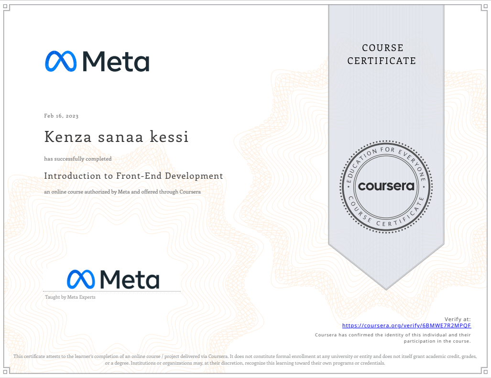
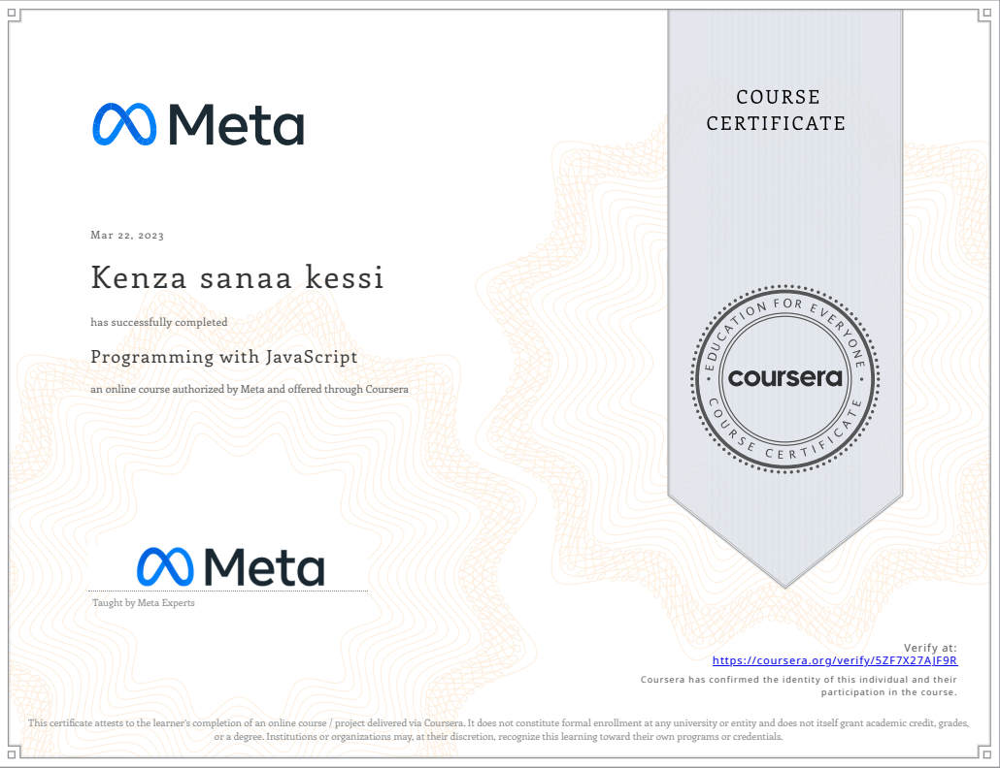

- 👋 Hi, I’m kenza
- 👀 I’m a software engineering student in SPBSTU
- 🌱 I’m currently practicing frontend and UIUX design, and learning SQL
- ⚡ i'm sharing all the codes of my learning journey 

<!---
kenzasanaa/kenzasanaa is a ✨ special ✨ repository because its `README.md` (this file) appears on your GitHub profile.
You can click the Preview link to take a look at your changes.
--->

## Certificates and diplomas

  
<b>Click to view my certificates</b>

   

  

    
    
  

